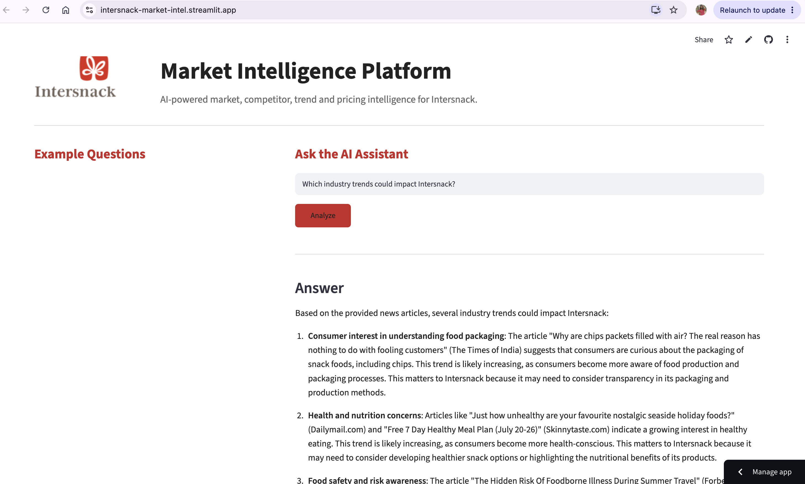
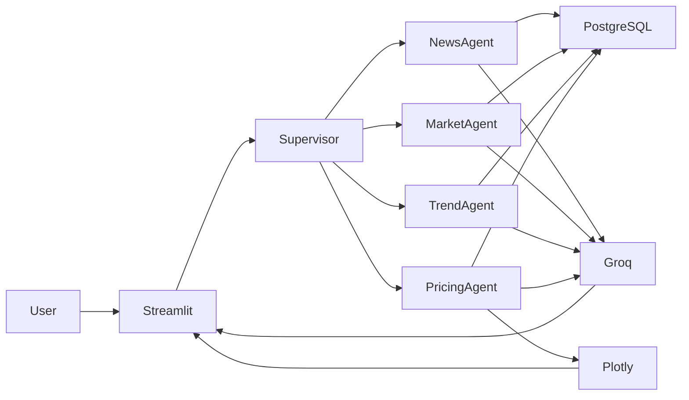
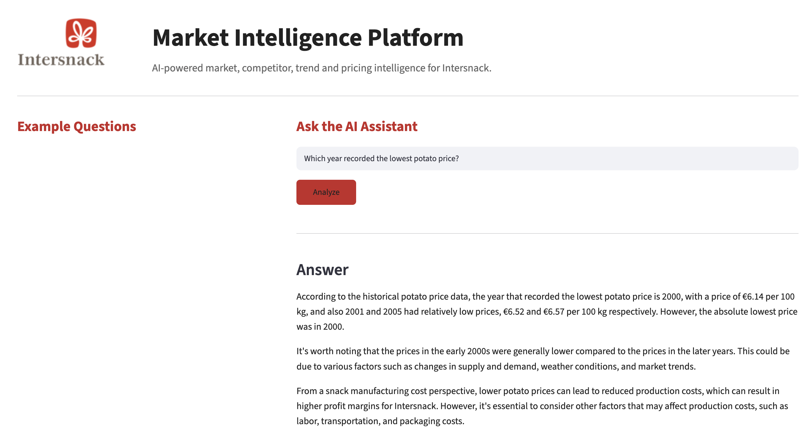
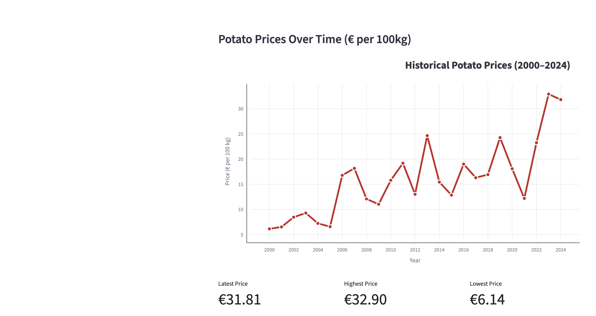

# 🥔 Intersnack Market Intelligence Platform

<p align="center">


</p>

An AI-powered **Market Intelligence Platform** for the snack industry that combines **Agentic AI, Retrieval-Augmented Generation (RAG), PostgreSQL, and interactive analytics** to deliver business insights from industry news, competitor activity, consumer trends, and commodity prices.

🌐 **Live Demo:** https://intersnack-market-intel.streamlit.app

---

# 📸 Live Application

<p align="center">

</p>

---

# ✨ Features

- 🤖 Multi-agent AI architecture
- 📰 Latest snack industry news summarisation
- 🏪 Competitor & brand intelligence
- 📈 Consumer trend analysis
- 🥔 Historical potato price analytics
- 📊 Interactive Plotly visualisations
- 🧠 LLM-powered business insights using **Groq Llama 3.3 70B**
- 🎯 Automatic query routing to specialised AI agents

---

# 🏗️ Architecture



---

# 🛠 Tech Stack

| Category | Technologies |
|-----------|--------------|
| Frontend | Streamlit |
| AI | Groq Llama 3.3 70B, LangChain |
| Backend | Python, SQLAlchemy |
| Database | PostgreSQL (Neon) |
| Visualisation | Plotly |
| APIs | SerpAPI (Google News) |

---

# 📊 Data Sources

- 📰 Google News (via SerpAPI)
- 🗄 PostgreSQL / Neon
- 🥔 Historical Potato Price Dataset
- 🤖 Groq Llama 3.3 70B

---

# 📸 Application Demo

### Dashboard

Users interact with multiple specialised AI agents through a single conversational interface.

<p align="center">

</p>

---

### Pricing Intelligence

The Pricing Agent combines structured potato price data with LLM reasoning to generate business insights alongside interactive Plotly visualisations.

<p align="center">

</p>

---

# 💬 Example Questions

```text
What are the latest snack industry news?

Compare Lay's and Pringles.

What consumer trends are emerging?

Show historical potato prices.

Why have potato prices increased?

What opportunities exist in premium snacks?
```

---

# 🚀 Run Locally

```bash
git clone https://github.com/vidyashreerayar/intersnack-market-intelligence-demo.git

cd intersnack-market-intelligence-demo

pip install -r requirements.txt

streamlit run app.py
```

Create a `.env` file:

```env
GROQ_API_KEY=

SERPAPI_API_KEY=

DB_HOST=

DB_PORT=

DB_NAME=

DB_USER=

DB_PASSWORD=
```

---

# 👩‍💻 Author

**Vidyashree Rayar**

M.Sc. Artificial Intelligence  
BTU Cottbus–Senftenberg

---

⭐ If you found this project interesting, consider giving the repository a star.